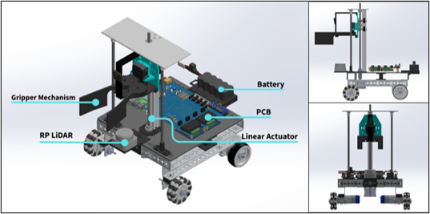

## Overview

An autonomous mobile manipulator developed in ROS 2 for "burger" assembly and delivery, featuring real-time LiDAR and camera processing, sensor fusion, path planning, and control.

## Demo Video

https://youtu.be/lLfEOGIN_Uo

---

## Table of Contents
- [Objectives](#objectives)
- [Key Results](#key-results)
- [Autonomy Stack & Control Design](#autonomy-stack--control-design)
- [System Architecture](#system-architecture)
- [Robot CAD Model](#robot-cad-model)
- [Repository Structure](#repository-structure)
- [Important Documents](#important-documents)

---

## Objectives
* **Traffic Light Detection**: The robot should detect the traffic light and only start moving when it turns green.
* **Burger Assembly**: The robot must stack the buns and patty to assemble the burger.
* **Navigation and Obstacle Avoidance**: The robot must navigate through the obstacle course, which includes tight corridors, ramps, and cones in unknown positions.
* **Gender Classification and Delivery**: The robot should perform customer face identification and deliver the burger to the correct customer.

## Key Results
* Successfully completed full multi-stage navigation, assembly, and delivery.
* Navigated through multiple unknown obstacle configurations with zero collisions.
* Achieved a 100% success rate on traffic light state detection and customer face identification.
* Delivered an 87% grasp success rate for assembly with zero burger drops during ramp ascent and descent.

## Autonomy Stack & Control Design
* **Hybrid Navigation Planner:** Combines Pure Pursuit path tracking with reactive Artificial Potential Fields (APF) at 10 Hz into a continuous resultant steering vector without discrete switching.
* **Sensor Fusion & State Estimation:** Uses an extended Kalman Filter (EKF) to fuse wheel and LiDAR odometry for robust pose estimation.
* **Traction Management:** Dynamically scales forward velocity based on steering sharpness and clamps angular velocity to 0.6 rad/s to mitigate wheel slip and wheel odometry drift.
* **Dynamic Parameter Scheduling:** Schedules the Kalman Filter covariances and LiDAR repulsion boundary per path segment, preventing wall interference and chatter in tight corridors while maintaining obstacle avoidance capabilities.
* **Multi-stage Perception Pipeline:** Integrates a lightweight YOLO network (416×416) for primary object detection (traffic signals, people, stop signs) paired with localized HSV and OpenCV template matching on extracted ROIs.

## System Architecture

**High-Level Autonomy (Raspberry Pi 5 + ROS 2)**
- Manages FSM states, LiDAR scan transformations, and navigation planner
- Executes YOLO object detection and classification

**Low-Level Control (Arduino Mega 2560)**
- Handles real-time control for DC motors (with wheel encoder feedback), linear actuator stepper motor, and gripper servo
- UART communication to Raspberry Pi

**Hardware**
- Custom gripper design
- Custom PCB integrates Arduino, motor drivers, and power management

---

## Robot CAD Model



---

## Repository Structure

```
├── assets/         Shared repo assets
├── docs/           Cross-project architecture, protocol, and design docs
├── firmware/       Arduino firmware and firmware-specific docs
├── mechanical/     CAD files for chassis and manipulators
├── nuevo_board/    PCB design files (schematics, layouts, BOM)
├── nuevo_ui/       Raspberry Pi bridge + web UI
├── ros2_ws/        ROS2 workspace and Pi-side tests
└── tlv_protocol/   TLV type definitions, payload schemas, generators
```

## Important Documents

| Document | Purpose |
|----------|---------|
| [docs/README.md](docs/README.md) | Cross-project documentation map and source-of-truth index |
| [docs/COMMUNICATION_PROTOCOL.md](docs/COMMUNICATION_PROTOCOL.md) | Current human-readable source of truth for protocol behavior, framing, and logical TLV design |
| [docs/DESIGN_GUIDELINES.md](docs/DESIGN_GUIDELINES.md) | Cross-project conventions, numbering rules, and protocol update workflow |
| [tlv_protocol/TLV_Payloads.md](tlv_protocol/TLV_Payloads.md) | Exact payload layouts and sizes |
| [firmware/README.md](firmware/README.md) | Arduino firmware overview, current features, and build instructions |
| [firmware/docs/README.md](firmware/docs/README.md) | Firmware subsystem documentation index |
| [NUEVO board/SPECIFICATIONS.md](NUEVO%20board/SPECIFICATIONS.md) | PCB hardware specifications |

---


